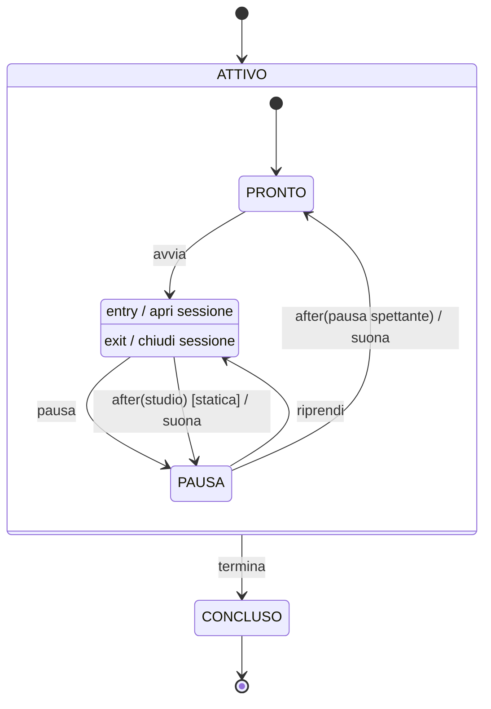

# Statechart del timer

Questo diagramma mostra come si comporta il timer: in quali stati può trovarsi e cosa lo fa passare da uno all'altro. In pratica dice le stesse cose della tabella di RF8 in [01-requisiti.md](01-requisiti.md), ma in forma di disegno.

## Come si legge

- **Riquadri e frecce.** Ogni riquadro è uno stato. Ogni freccia è un passaggio da uno stato all'altro e porta scritto cosa lo provoca. Il pallino nero indica da dove si parte e dove si finisce.
- **La scritta su una freccia** ha la forma `evento [condizione] / azione`. L'evento è ciò che succede; la condizione, se c'è, deve essere vera perché il passaggio avvenga; l'azione è ciò che il timer fa durante il passaggio. Per esempio `after(studio) [statica] / suona` vuol dire: *quando finisce il tempo di studio, ma solo in modalità statica, il timer suona e va in pausa*.
- **`after(...)` è un evento a tempo.** Non lo fa partire l'utente: scatta da solo quando è passato un certo tempo da quando si è entrati nello stato.
  - In STUDIO aspetta il tempo di studio impostato, e solo in modalità statica. In modalità dinamica si studia finché si vuole.
  - In PAUSA aspetta la pausa spettante (RF10), in entrambe le modalità.
- **Il riquadro grande ATTIVO** raccoglie PRONTO, STUDIO e PAUSA. La freccia `termina` parte dal suo bordo e quindi vale per tutti e tre gli stati interni: una freccia sola invece di tre.
- **Le azioni di STUDIO.** `entry` è ciò che succede quando si entra nello stato, `exit` è ciò che succede quando se ne esce. Entrare in STUDIO apre una sessione e uscirne la chiude, qualunque sia la freccia: pausa, fine del tempo o termina. Per questo non serve scrivere "chiudi sessione" su ogni freccia.
- **Ciò che non è disegnato non è permesso.** Se arriva un evento che nello stato attuale non ha una freccia, per esempio `riprendi` mentre si sta già studiando, il timer lo rifiuta e resta com'era.

## Un esempio passo passo

Modalità statica, 25 minuti di studio e 5 di pausa:

| Ora | Cosa succede | Stato |
|---|---|---|
| 15:00 | si preme "avvia" e si apre una sessione | STUDIO |
| 15:25 | il tempo di studio finisce, suona; si salva la sessione 15:00–15:25 | PAUSA |
| 15:30 | la pausa finisce e suona | PRONTO |
| 15:32 | si preme "avvia" e si apre una nuova sessione | STUDIO |
| 15:40 | si preme "termina"; si salva la sessione 15:32–15:40 | CONCLUSO |

Risultato: due sessioni, per un totale di 33 minuti di studio.

## Dal diagramma al codice

Ogni elemento del diagramma ha il suo corrispondente in `src/domain.py`:

| Nel diagramma | Nel codice |
|---|---|
| lo stato in cui si trova il timer | `Timer.stato` |
| gli eventi avvia, pausa, riprendi, termina | le funzioni con lo stesso nome |
| gli eventi a tempo `after(...)` | `aggiorna(timer, adesso)` |
| quanto manca al prossimo `after` | `secondi_rimanenti(timer, adesso)` |
| un evento rifiutato | l'errore `TransizioneNonValida` |
| apertura e chiusura della sessione | il campo `inizio_sessione` e la `Sessione` restituita |

Gli eventi a tempo non hanno bisogno di un orologio che scandisce i secondi. A ogni richiesta l'app legge l'ora una volta sola e chiama `aggiorna`, che applica in ordine tutte le scadenze già passate. Se si torna dopo un'ora, il timer sa cosa è successo nel frattempo e la sessione risulta chiusa quando è suonato, non quando si è tornati.
